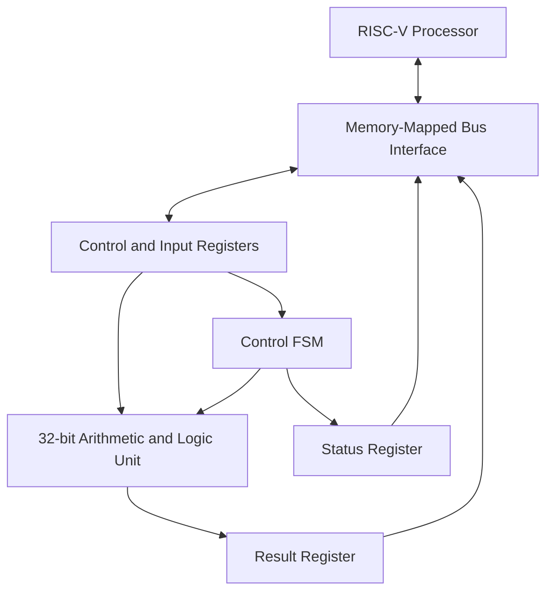
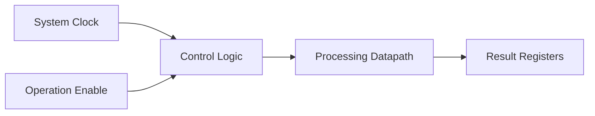

# Design & Verification of a Low-Power RISC-V SoC Peripheral

### RTL Design | SystemVerilog Verification | Low-Power Design | ASIC Implementation

## 1. Project Overview

This project focuses on designing and verifying a low-power, memory-mapped hardware peripheral intended for integration with a RISC-V-based System-on-Chip (SoC).

The peripheral will contain a configurable arithmetic processing unit, control logic, input registers, status registers, and result registers. A RISC-V processor will be able to configure the peripheral, provide operands, initiate operations, and retrieve results through a defined bus interface.

The project aims to demonstrate the complete digital hardware development process, from architecture and RTL design to functional verification, synthesis, timing analysis, and power evaluation.

**Current Status:** Stage 1 — Architecture and Specification completed as documentation. RTL implementation is the next step.

## 2. Project Objectives

* Design a configurable hardware peripheral for a RISC-V-based SoC.
* Develop synthesizable RTL using Verilog/SystemVerilog.
* Implement memory-mapped control, input, status, and result registers.
* Develop a control mechanism for managing hardware operations.
* Explore clock-enable-based activity reduction.
* Verify functionality using a SystemVerilog testbench.
* Analyze synthesis area, timing, and power using available EDA tools.
* Explore an RTL-to-GDSII implementation flow where supported by the available tools and technology libraries.

## 3. System Architecture

The following diagram illustrates the proposed system architecture.



### Architecture Description

**RISC-V Processor:** Initiates operations and accesses peripheral registers.

**Memory-Mapped Bus Interface:** Handles processor read and write requests.

**Control and Input Registers:** Store operands, operation selection, and control information.

**Control FSM:** Coordinates operation execution and status updates.

**Arithmetic and Logic Unit:** Performs the selected arithmetic or logical operation.

**Status Register:** Reports whether the peripheral is busy or an operation has completed.

**Result Register:** Stores the computed output for processor access.

The diagram represents the proposed architecture. The bus protocol and integration details will be finalized before RTL implementation.

## 4. Functional Specifications

The initial design will support the following 32-bit operations.

| Opcode | Operation | Function |
| :----: | --------- | -------- |
|   000  | ADD       | A + B    |
|   001  | SUB       | A - B    |
|   010  | AND       | A & B    |
|   011  | OR        | A | B    |
|   100  | XOR       | A ^ B    |

The initial design will use two 32-bit operands and produce a 32-bit result.

For example:

* Operand A = 10
* Operand B = 5
* Operation = ADD
* Expected result = 15

Additional arithmetic and logical operations may be considered in future revisions.

## 5. Proposed Register Map

The peripheral will use a 32-bit memory-mapped register interface.

| Offset Address | Register | Access | Description                 |
| :------------: | -------- | :----: | --------------------------- |
|      0x00      | CONTROL  |   R/W  | Operation start and control |
|      0x04      | INPUT_A  |   R/W  | First operand               |
|      0x08      | INPUT_B  |   R/W  | Second operand              |
|      0x0C      | CONFIG   |   R/W  | Operation selection         |
|      0x10      | STATUS   |    R   | Busy and completion status  |
|      0x14      | RESULT   |    R   | Computed output             |

These are proposed register offsets relative to the peripheral's base address. The actual base address will be assigned during SoC integration.

### Register Bit Definitions

**CONTROL Register**

| Bit | Name   | Description                  |
| :-: | ------ | ---------------------------- |
|  0  | ENABLE | Enables peripheral operation |
|  1  | START  | Requests an operation        |

**CONFIG Register**

| Bits  | Description                                  |
| ----- | -------------------------------------------- |
| [2:0] | Selects the operation using the opcode table |

**STATUS Register**

| Bit | Name | Description                           |
| :-: | ---- | ------------------------------------- |
|  0  | BUSY | Indicates an operation is in progress |
|  1  | DONE | Indicates operation completion        |

The exact behavior of START, DONE clearing, reset values, and invalid operations will be defined before implementation.

## 6. Low-Power Design Strategy

Power reduction is an important objective of this project.

The initial approach will investigate clock-enable-based activity reduction.



The processing datapath and related registers will be designed to avoid unnecessary state updates when no operation is requested.

The design will investigate:

* Clock-enable-based state updates.
* Avoiding unnecessary register writes.
* Reducing unnecessary switching activity.
* Comparing activity and power estimates between baseline and optimized implementations.

Power improvement will be claimed only if supported by measurements or tool reports under comparable conditions.

Clock enables and integrated clock gating are different techniques. Actual clock gating will only be implemented if the selected flow supports a suitable, safe implementation.

## 7. RTL Design Plan

The proposed RTL hierarchy is:

```text
peripheral_top
│
├── bus_interface
│
├── register_bank
│
├── control_fsm
│
└── alu
```

### Planned Modules

| Module           | Responsibility                                      |
| ---------------- | --------------------------------------------------- |
| `peripheral_top` | Integrates the peripheral modules                   |
| `bus_interface`  | Handles register read/write transactions            |
| `register_bank`  | Stores operands, configuration, status, and results |
| `control_fsm`    | Controls operation sequencing                       |
| `alu`            | Performs arithmetic and logical operations          |

The implementation will use synthesizable Verilog/SystemVerilog constructs.

The bus interface will be finalized before implementation. A lightweight custom interface may be used for an initial standalone prototype, while integration with an existing SoC may require an established protocol such as APB or AXI4-Lite.

## 8. Verification Plan

SystemVerilog will be used to verify the design.

Planned verification activities include:

* Reset behavior verification.
* Register read/write testing.
* Arithmetic and logical operation testing.
* Opcode selection testing.
* Invalid operation testing.
* Back-to-back operation testing.
* Busy and completion status verification.
* Corner-case operand testing.
* Assertions for important control and protocol properties.
* Functional coverage for operations and important scenarios.
* Automated checking of actual results against expected results.

A self-checking testbench and verification results will be added as implementation progresses.

## 9. Tools and Technologies

| Tool / Technology    | Intended Use                                                        |
| -------------------- | ------------------------------------------------------------------- |
| Verilog              | RTL design                                                          |
| SystemVerilog        | Testbench, assertions, and functional coverage                      |
| AMD Xilinx Vivado    | RTL simulation and FPGA-oriented synthesis                          |
| Cadence EDA tools    | ASIC design and analysis, depending on installed tools and licenses |
| VSD user environment | Open-source EDA workflow, depending on installed t                  |
